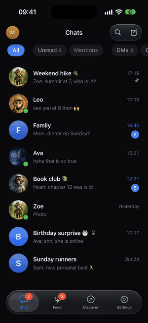
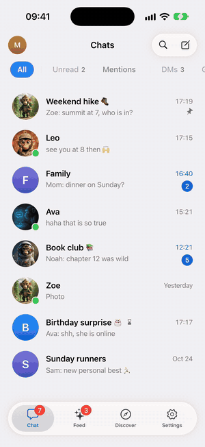
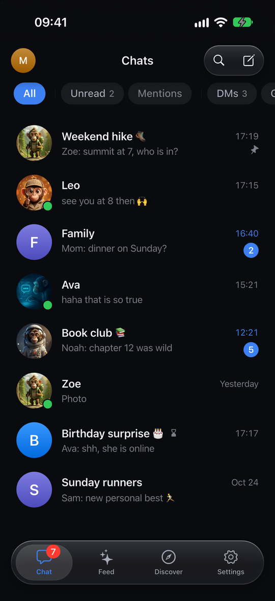
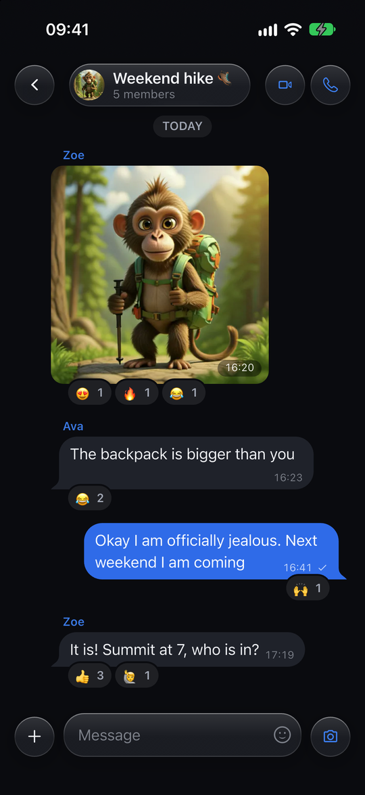
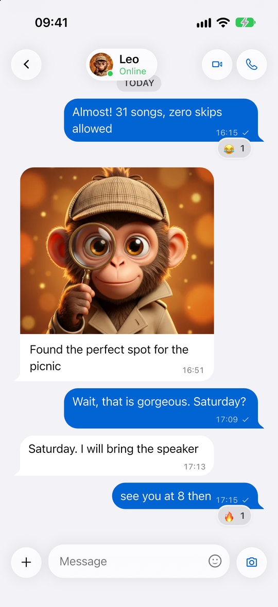
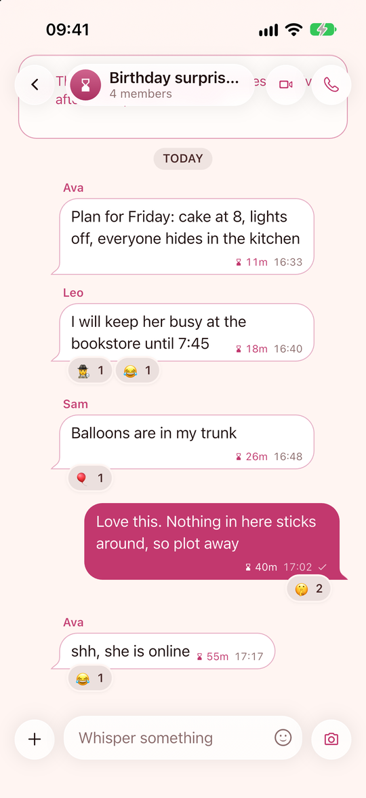
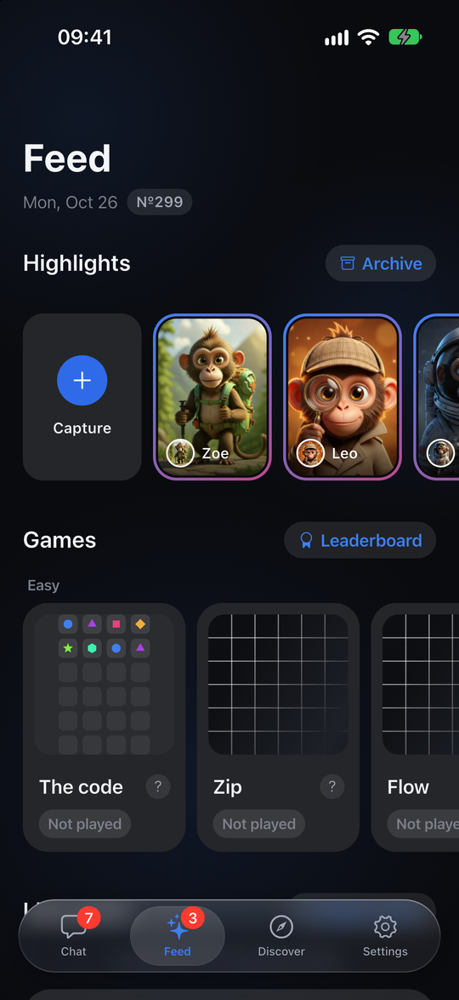
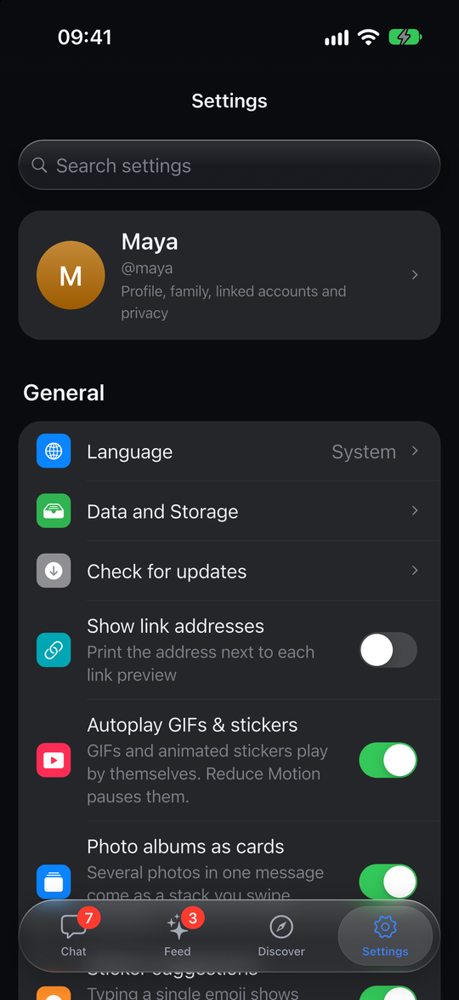

<div align="center">


# MonkeyHub

**Rooms, friends, secrets that fade.**

A private-first messenger with disappearing messages, calls, games and a feed of your friends' day.
One Flutter codebase for iOS, Android, macOS, Windows, Linux and web.


</div>

---

## See it move

<p align="center">
  
  &nbsp;&nbsp;&nbsp;
  
</p>
<p align="center"><sub>Live messages in a group chat &nbsp;·&nbsp; Themes, from Daylight to Forest</sub></p>

## Chats that feel alive

Rooms for family, friends and the team. Photos, tap reactions, read receipts, voice and video notes, and a calm glass design that follows your theme.

<p align="center">
  
  
  
</p>

## Secrets that fade

Secret rooms where every message self-destructs, plus view-once photos and videos. Sealed media sits behind a living dust veil: rub it with a finger to reveal, let go and it heals over.

<p align="center">
  
  
  
</p>

## Your friends' day, and a little game

A daily feed of highlights from your closest friends, with fresh puzzles and chat games to challenge them.

<p align="center">
  
  
  
</p>

## Highlights

- **Calls:** 1:1 and group voice and video over WebRTC, with native CallKit ringing on iOS and a floating in-app call window
- **Disappearing everything:** self-destructing rooms, view-once media, per-message lifetimes
- **Games:** daily puzzles, live and async chat games, party games and bots
- **Every platform:** iOS, Android, macOS, Windows, Linux and web, with a split-view desktop shell, keyboard shortcuts and drag and drop
- **12 languages**, light and dark, 16 themes
- **Direct push:** APNs, FCM and Web Push, no third-party relay

## Tech

| Layer | What |
| --- | --- |
| App | Flutter / Dart, one codebase for six targets |
| Backend | Self-hosted [Convex](https://convex.dev) (`backend/convex`), TypeScript |
| Realtime | `convex_flutter` (vendored, patched) |
| Calls | `flutter_webrtc` (vendored, patched) and TURN (`backend/turn`) |
| Effects | Custom painters, shaders and shared-element flights |

```
lib/            Flutter app (screens, calls, games, composer, theme, l10n, ...)
backend/        Convex functions, schema, TURN config, scripts
third_party/    Vendored and patched plugins
docs/           Specs, audits and design notes
test/           Unit and widget tests
```

## Getting started

```bash
flutter pub get
(cd backend && npm install)
cp env.example env.local      # then fill it in
flutter run                   # pick a device
```

Run a single test file with `flutter test test/<file>_test.dart`, and type-check the backend with `npm run typecheck` in `backend/`.

## More docs

[Glass design spec](docs/GLASS_SPEC.md) ·
[Deploying](DEPLOY.md) ·
[Calling audit](CALLING_AUDIT.md) ·
[Notifications](NOTIFICATION_SETUP.md) ·
[Deep links](DEEP_LINKS.md) ·
[Share sheet](SHARE_SHEET.md)

---

<div align="center">Made with 🐒 by Murat Can Koç</div>
