<div align="center">


# MonkeyHub

**Rooms, friends, secrets that fade.**

A private-first messenger with disappearing messages, calls, games and a feed of your friends' day.
One Flutter codebase for iOS, Android, macOS, Windows, Linux and web.


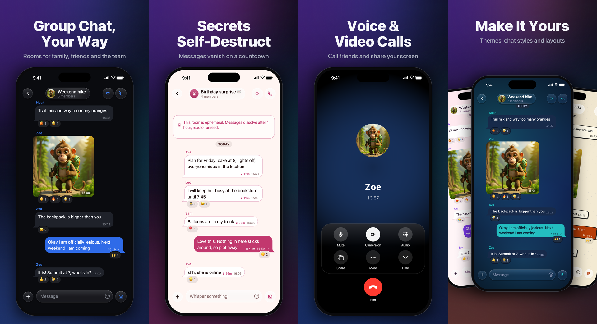

</div>

---

## Features

### Group chats and DMs that feel alive
Rooms for family, friends and the team. Photos, reactions in a tap, read receipts, voice notes and video notes.

<p align="center">
  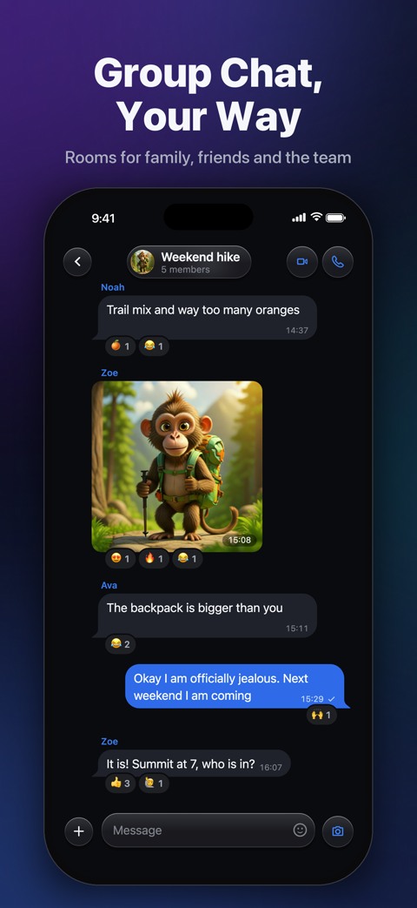
  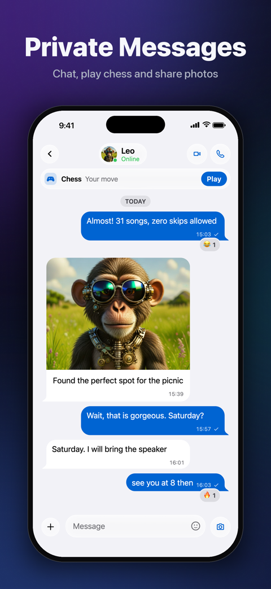
  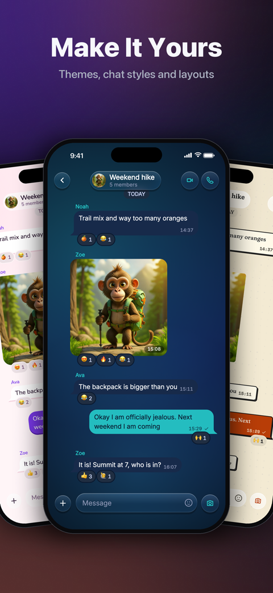
</p>

### Secrets that fade
Secret rooms where every message self-destructs, plus view-once photos and videos. Sealed media is hidden behind a living dust veil: rub it with a finger to reveal, let go and it heals over.

<p align="center">
  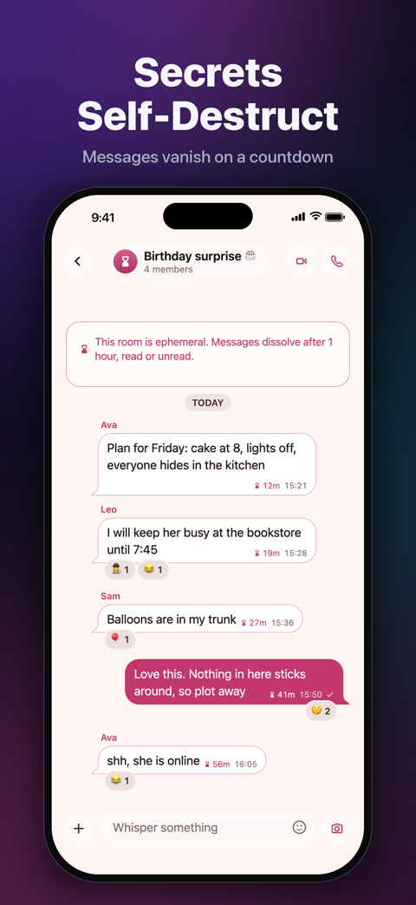
  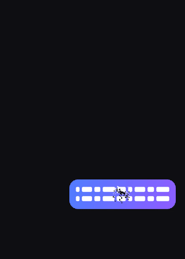
  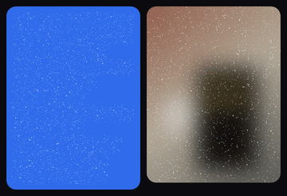
</p>

### Voice and video calls
1:1 and group calls over WebRTC, with native CallKit and PushKit ringing on iOS, a floating in-app call window and live quality switching.

<p align="center">
  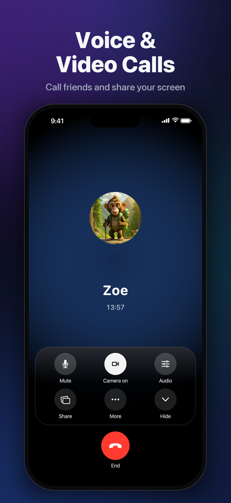
</p>

### Games, together
Daily puzzles, live and async chat games, party games and bots, right inside the conversation. Your friends' highlights and scores land in the feed.

<p align="center">
  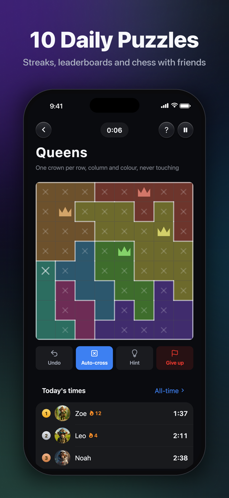
  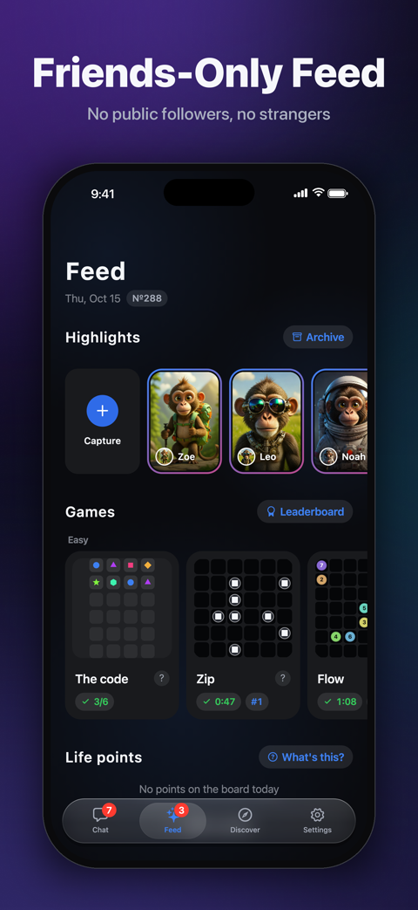
  
</p>

### Desktop is a first-class citizen
Split-view shell, keyboard shortcuts, hover states, drag and drop, and native share sheets.

<p align="center">
  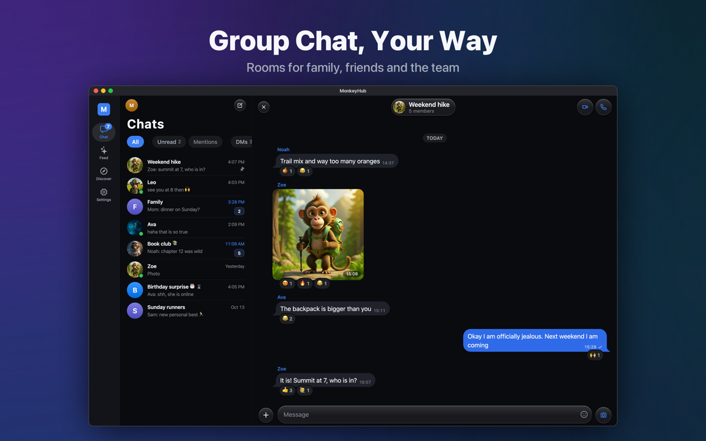
</p>
<p align="center">
  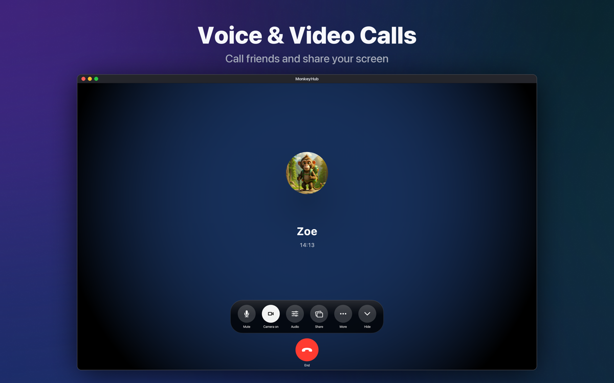
</p>

### Also
- 12 languages
- Light, dark and custom themes with a glass design language
- Live location, stickers and GIFs, scheduled messages
- Direct APNs / FCM / Web Push notifications
- Share-sheet extension on iOS

---

## Tech stack

| Layer | What |
| --- | --- |
| App | Flutter / Dart, one codebase for 6 targets |
| Backend | Self-hosted [Convex](https://convex.dev) (`backend/convex`), TypeScript |
| Realtime | `convex_flutter` (vendored, patched) |
| Calls | `flutter_webrtc` (vendored, patched) + TURN (`backend/turn`) |
| Push | APNs, FCM and VAPID directly |
| Media | `record`, `just_audio`, custom shader and painter effects |

## Project layout

```
lib/            Flutter app (screens, calls, games, composer, theme, l10n, ...)
backend/        Convex functions, schema, TURN config, scripts
third_party/    Vendored and patched plugins (convex_flutter, flutter_webrtc, callkit)
ios/ macos/ android/ windows/ linux/ web/   Platform runners
docs/           Specs, audits and design notes
test/           Unit and widget tests
```

## Getting started

```bash
# 1. Dependencies
flutter pub get
(cd backend && npm install)

# 2. Config: copy the example env and fill it in
cp env.example env.local

# 3. Run
flutter run                      # pick a device
(cd backend && npm run typecheck)  # backend type check
```

Run a single test file with `flutter test test/<file>_test.dart`.

## More docs

[Glass design spec](docs/GLASS_SPEC.md) ·
[Deploying](DEPLOY.md) ·
[Calling audit](CALLING_AUDIT.md) ·
[Notifications](NOTIFICATION_SETUP.md) ·
[Deep links](DEEP_LINKS.md) ·
[Share sheet](SHARE_SHEET.md) ·
[Data integrity plan](docs/data-integrity-and-scale-plan-2026-10-22.md)

---

<div align="center">Made with 🐒 by Murat Can Koç</div>
